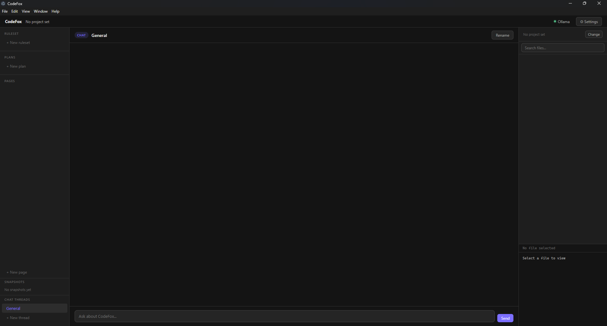

# CodeFox

A free, local AI coding assistant that runs entirely on your machine. No cloud. No credits. No data leaving your computer.

Built on Electron + SQLite, with [LM Studio](https://lmstudio.ai) as the default local model backend and [Ollama](https://ollama.com) as an alternative backend.

 

---



---

## What it does

- **Home** — the default view when CodeFox opens: a banner for the active project, connection cards (Unity / local folders), a Discover Skills grid, recent references, and a "What do you want to build?" panel that starts a new conversation. The app icon is the same kitsune nine-tails mark shown on Home
- **Multiple projects** — keep several local projects in CodeFox, each with its own conversations, rulesets, plans, and references. Switch from the project selector at the top of the sidebar, or create a new one with **New Project**. No accounts, no teams, no sync — everything stays on this machine
- **Chat** with a local LLM about your codebase across persistent conversations
- **Ask / Plan / Agent modes** — Ask answers and explains only, Plan drafts steps and file lists without writing code, Agent works step by step and outputs complete code in fenced blocks with file paths
- **Agent mode (the loop)** — in Agent mode the assistant runs its own commands, reads the output, and tries again on its own (build, see the error, fix it, rebuild), up to a max number of tool rounds, with a Stop button and approval bars for anything risky
- **Unity Package Manager** — the assistant can install and remove Unity packages by editing `Packages/manifest.json` (backed up first, Unity refreshes after). Package installs always ask first, and a missing version is never guessed — you type it in the approval bar
- **Project scan** — reads your Unity project (version, packages, scenes, prefabs, scripts) and includes a summary in every prompt, so the model knows what actually exists instead of guessing
- **Rulesets** — define project rules, architecture contracts, naming conventions. Auto-injected into every prompt.
- **Plans** — describe what you want done. The AI proposes steps and lists files before touching anything. You approve, then execute.
- **References** — pages and plans in one list: AI-authored architecture docs (pages) and step-by-step plans, kept per project so they grow into a living knowledge base
- **Skills** — one-click actions from Home: draft a Game Design Document, plan a feature prototype, migrate UGUI to UI Toolkit, or audit the project structure. Figma and Jira skills need a connection first (see Connections) and say so honestly instead of faking it. File-based skills (Settings → Skills) are a separate mechanism: folders of markdown the assistant reads on demand, starting with multiplayer networking
- **Connections** — a single view for LM Studio, Ollama, the Unity bridge, Figma, Jira, and GitHub, each with a real status and an action that either does the thing or says what is still needed. The Unity bridge really installs `CodeFoxBridge.cs` into `Assets/Editor/` (and can be removed again from Settings → Connections, which deletes the file); it installs automatically whenever a Unity project is connected, and opening Settings → Connections on a project without a bridge installs it then. Figma/Jira tokens are stored locally and used only for those imports
- **MCPs** — configure local MCP servers (command, arguments, environment) in Settings → MCPs, with ten recommended presets and a guided setup prompt that walks through the steps and checks each token or app for real. Servers run on this machine; the assistant does not call MCP tools yet, and the UI says so — the settings are stored so that wiring can be added without reconfiguring
- **ComfyUI** — a native integration with a locally running ComfyUI (default `http://127.0.0.1:8188`): **Scan for ComfyUI** finds the install, workflows and models in the usual places; import your own workflow JSON files, see which nodes and models each one needs, generate images from a simple prompt-first form in the ComfyUI panel (or from the Agent loop), and import the results into the project under `Assets/Generated/<workflow>/`. Only workflows you approve run from the Agent loop without asking
- **Shell tool** — with the shell off by default, the assistant's PowerShell blocks never run on their own. Turn it on in Settings → Advanced to run commands, auto-approve safe prefixes, or auto-accept project changes (still snapshotted first, always revertible)
- **File tree** — browse your project, view files, add them to chat with one click. Search across all files instantly.
- **Apply changes** — LLM responses containing code blocks get a one-click "Apply changes" button that writes files to disk. A **Review diff** button shows a line-by-line diff before you apply.
- **Snapshots + Revert** — before writing anything, CodeFox backs up every file it touches, and records new files so revert can delete them. One click to revert if something breaks.
- **Test loop** — generate EditMode tests for a script, run them in Unity batch mode, and paste the failures back to the model to fix, one at a time. A `dotnet build` check is available too.
- **Error diagnosis** — paste a Unity console error or log and get a plain-language explanation, the likely file and line, and the smallest fix to try first.
- **Animator + UI generation** — ask the model to generate Editor scripts that build an Animator Controller or a UI Canvas in Unity.
- **Asset moves that preserve GUIDs** — moving a file through CodeFox moves its `.meta` file with it.
- **Unity integration** — includes an Editor companion script that auto-refreshes Unity's AssetDatabase when files change, and can execute commands (refresh, create an Animator Controller, create a UI Canvas, and — since v0.9.0 — create and change prefabs, and list/describe the component types in your Unity install; since v0.11.0 it can also read the Unity console) written to `Assets/.codefox-command.json`.

---

## Requirements

- [Node.js](https://nodejs.org) 18+
- A local model backend — **LM Studio** (default) or Ollama (alternative)
- A coding model loaded in that backend (see "Choosing a model" below)
- Unity, if you want the Unity features (project scan, tests, bridge)

---

## Setup

```bash
# 1. Clone the repo
git clone https://github.com/YOUR_USERNAME/codefox.git
cd codefox

# 2. Install dependencies
npm install

# 3. Run
npm start
```

### Updating CodeFox

```bash
git pull
npm ci
npm run build:win
```

`git pull` should now just work, with no restore step. The reason it kept blocking before: every build rewrote `unity-bridge-source.js`, a file that was tracked in git, so the working tree was dirty after every build and the next pull refused to overwrite it (the same class of problem as `package-lock.json`, which `npm install` rewrites). That file is now generated and ignored, like the app icons — it is regenerated at install/start/build time — so no build step modifies a tracked file any more.

Use `npm ci` instead of `npm install` when dependencies change: `npm ci` installs exactly what the lockfile says and never rewrites it, while `npm install` can. If a pull ever still complains about a local change, `git restore <file>` remains the escape hatch, and it is safe for generated files.

One-time note: if you ran the old `npm install-scripts approve electron` step, it wrote an `allowScripts` entry into your local `package.json` — a local change that will show up once. Restoring `package.json` once removes it. Whether the approval is even needed is uncertain: Node 26 ships npm 11, which warns about install scripts but still runs them — only npm 12 blocks them by default — so the approval may have been a red herring all along.

If buttons ever stop responding, the app now says so on screen: on startup it checks it can reach the main process, and if it cannot, a red or amber banner appears at the top of the window naming the failure ("bridge missing" or "bridge timeout"). Report that exact message — it is the diagnosis.

If buttons stop responding or a connection check does nothing, open **Settings → Advanced → Developer tools** and look at the red errors in the Console tab — that is the fastest way to find out what broke.

### 1. Start LM Studio

1. Install [LM Studio](https://lmstudio.ai) and download a coding model (see below).
2. Load the model in LM Studio and start its local server — by default on `http://localhost:1234`.
3. In CodeFox, click ⚙ **Settings** → Provider: **LM Studio** → **Verify connection**. You should see how many models the server found.
4. Pick a model from the **Model** dropdown (populated from the live server list, not typed by hand) and click **Save**.

No API key is needed for a default LM Studio server; there is an optional API key field in Settings if your server requires one.

### Loading a model from CodeFox

Settings → Model also lists every model LM Studio has downloaded, each with a **Load** button. CodeFox loads models into a running LM Studio server with tuned settings — full GPU offload, KV cache Q8, 1 concurrent prediction, 16K context, flash attention — and it does not start the server, and speed depends on the model and the machine. Loading a model sets it as the active model.

Why the tuned settings exist: a model loaded with LM Studio's own defaults (4 parallel predictions, FP16 KV cache, partial GPU offload) splits work between VRAM and system RAM and crawls — on this machine that was 2.55 t/s for a 30B model, where the same machine gets ~30 t/s with the tuned load. The settings are global: the same six values for any model, no per-model overrides. Two channels, because LM Studio splits them: the REST load carries context length, eval batch size, flash attention and KV-cache offload, while KV cache quantization, concurrent predictions and the GPU offload ratio are written into LM Studio's per-model saved settings (`%USERPROFILE%\.lmstudio\.internal\user-concrete-model-default-config\<model>.json`) before the load — LM Studio applies those on every load of the model. Loading never unloads other models and never runs on startup; it is an explicit Load click only. If the server is not running, Load fails plainly instead of pretending it worked, and after every load CodeFox checks the model is actually in the loaded list before reporting success.

Verify is load-state aware: it checks LM Studio's native model list (`GET /api/v1/models`, falling back to `/api/v0/models`, then the OpenAI-compatible list), because the OpenAI-compatible `/v1/models` may list downloaded models too when Just-In-Time loading is on — so appearing there does not prove a model is loaded. A model that is downloaded but not loaded fails verify plainly ("downloaded but not loaded — load it in Settings") instead of passing and dying at the probe. Settings → Model shows the active model's loaded context ("Loaded context: 16,384 tokens", or "unknown" when the server doesn't report one), and replies are capped at half the loaded window — or 4096 tokens when the context is unknown — so the prompt plus the reply still fit. Your configured Max tokens per reply stays the ceiling; the cap only ever lowers it. A connection failure says plainly that LM Studio can't be reached and to start its server, instead of a raw error.

### Using Ollama instead

1. Install [Ollama](https://ollama.com) and pull a model, e.g. `ollama pull qwen2.5-coder:7b-instruct`.
2. In CodeFox Settings, set Provider to **Ollama**, enter the Ollama URL and model name, and save. CodeFox can auto-launch Ollama on startup if it finds `ollama.exe`.

### Choosing a model

Local models are a trade-off between speed, memory, and capability. Honest guidance:

| Model size | VRAM (rough) | Notes |
|---|---|---|
| 7B | ~4–8 GB | Fast, good for single-file edits and questions. Weak at multi-file refactors. |
| 14B | ~10–12 GB | A good middle ground for most machines. |
| 32B | ~20 GB+ | Strongest local option, but slow on consumer GPUs and needs a lot of VRAM. |

Smaller models are faster but weaker at multi-file refactors. Keep prompts and plans small — one step at a time, one file at a time — and use Plan mode to break work down before Agent mode writes code.

---

## How to use

### Home

CodeFox opens on **Home**: the project banner, connection cards, skills, and recent references for the active project. The right-hand panel asks "What do you want to build?" — pick a starter pill (**Debug an issue**, **Build a tool**, **Write a script**) or type your own prompt, and it starts a new conversation in chat mode. The `@` button mentions the file open in the viewer; the **Agent** dropdown switches Ask / Plan / Agent, and the model name opens Settings.

### Projects

The project selector at the top of the sidebar shows the active project. Click it to switch projects, open **Project Settings** (rename, change the project folder), or create a **New Project** (name + folder). Each project keeps its own conversations, rulesets, plans, and references; switching refreshes the sidebar, file tree, and Home view. Deleting a project deletes its conversations and references with it, and the last project cannot be deleted.

### Conversations

Click a conversation in the sidebar to open it, or **＋ New conversation** to start one. The first item in the list is always the new-conversation entry.

### Modes

Use the **Ask / Plan / Agent** buttons above the chat input:

- **Ask** — the model answers and explains only. It will not propose file writes.
- **Plan** — the model outputs a plan: `FILE:` lines for every file to touch, then numbered steps. No code yet.
- **Agent** — the model works step by step and outputs complete code, one file per fenced block, each preceded by `**File Path:** \`path\``. In Agent mode CodeFox also runs the loop: after each reply it runs the model's safe commands, applies its file changes, and installs the packages it asked for, then sends the results back to the model so it can fix errors and retry — without you prompting again. See "Agent mode (the loop)" below.

A build, fix, or create request always runs in Agent mode, even if Ask is selected: Ask only explains, so sending it a build request would get a refusal ("I cannot do that, but I can walk you through the steps") — the model doing exactly what Ask told it to. CodeFox notices the change intent, switches to Agent mode for that turn, and says so in the chat. Genuine questions stay in Ask mode, and Plan mode is never switched — a plan is not a build.

### Tools

The tools row above the chat input:

| Button | What it does |
|---|---|
| Scan project | Scans the project folder (Unity version, packages, scenes, prefabs, scripts) and caches the summary for future prompts |
| Diagnose error | Inserts a prompt for pasting a Unity console error/log and getting a diagnosis |
| Generate tests | Inserts a prompt to write NUnit EditMode tests for the file open in the viewer |
| Animator | Inserts a prompt to generate an Editor script that builds an Animator Controller |
| UI | Inserts a prompt to generate an Editor script that builds a UI Canvas |
| Run tests | Runs EditMode tests in Unity batch mode (needs the Unity Editor path in Settings) and reports pass/fail |
| Build check | Runs `dotnet build` on the solution in the project, if one exists, and reports the result |

### Rulesets
Click **+ New ruleset** in the left panel. Write your project's rules, architecture contracts, hard constraints. Every chat message automatically includes these — the model always knows your standards.

Settings → **Rules** controls how much of them the model sees: each ruleset has an enabled toggle and a priority (higher is sent first), and a **prompt budget** (default 4000 characters, 1000–12000) caps how many characters of rules go with each message — whole rulesets only, never cut off mid-way. The section shows what was included in the last message and what was left out. **Condense rules** asks the model to squeeze the enabled rulesets under 500 characters while keeping every hard constraint; with **Use condensed rules when over budget** on, that condensed version is sent instead of dropping rules. If the model can't be reached, condensing fails honestly and changes nothing.

### Plans
Click **+ New plan**. Write what you want done in plain English, listing files to touch:
```
FILE: src/engine/MatchEngine.cs
FILE: src/handlers/DestroyCardHandler.cs

1. Refactor DestroyCardHandler to auto-enqueue RepackLaneRequest
2. Remove direct VFX calls from MatchEngine
3. Wire CardDestroyedEvent to EngineVFXListener
```
Click **▶ Execute plan** — CodeFox creates a dedicated thread, sends the plan to the LLM, and streams the response. When it finishes, if any code blocks are detected, an **Apply changes** bar appears.

### Apply + Revert
- **Apply** — writes files to disk (creating parent folders as needed), triggers Unity refresh (if configured), saves a snapshot
- **Auto-apply for new Unity assets** — when the assistant creates a NEW Unity-native file (a material, animation, controller, or similar — a file that contains no code), CodeFox writes it straight away after taking a snapshot, without asking you to click Apply. Code files (.cs, .shader, .js, .ts) and edits to files that already exist still show the Apply bar first, unless auto-accept is on. If the change set is mixed — any code file, or any edit to an existing file — the whole set asks first; auto-apply never writes half a set. Turn it off in Settings → Advanced → "Auto-apply new Unity asset files" (`auto_apply_unity_assets`, default on). Prefabs and scenes are never written by hand: the assistant creates and changes them through the Unity bridge (```unity-command blocks), and Unity writes the files itself — see "Unity integration" below.
- **Review diff** — shows added/removed/unchanged lines per file before you apply
- **Revert** — restores all modified files from the snapshot, and deletes files that were newly created by the apply. Triggers Unity refresh. The revert bar appears after EVERY apply — manual Apply, auto-accept, or auto-apply — and stays there until you click Revert or Keep. It never auto-dismisses, and a new chat message does not replace it.
- **Keep changes** — an explicit click that discards the snapshot, so the change can no longer be reverted. Nothing discards a snapshot automatically: not closing the app, not starting a new conversation. Only a Keep click does.
- **Snapshot history** — last 5 snapshots shown in the left panel, each with a ↩ revert button, so you can undo even after the revert bar is gone

### Reading and editing files

The assistant reads before it edits — it views the exact lines, then replaces that chunk, instead of rewriting a whole file to change a few lines. In Agent mode it has three file tools, in a ```file block with JSON:

- **view** — reads a file in line ranges, with line numbers: `{"action": "view", "path": "Assets/Scripts/Player.cs", "start": 40, "end": 80}`. At most 200 lines come back at once; the result says so when it was cut short. Paths are relative to the project folder — a path that escapes the project is refused.
- **grep** — searches plain text across the project (a substring, case-insensitive, not a regex): `{"action": "grep", "pattern": "Health"}`. Optionally narrow it with `"paths": ["Assets/Scripts"]`. Results are `file:line: matching line`, at most 50. Library, .git, node_modules and the other generated folders are never searched.
- **str_replace** — replaces ONE exact chunk of a file: `{"action": "str_replace", "path": "Assets/Scripts/Player.cs", "old": "  health = 100;", "new": "  health = 150;"}`. The old text must match exactly once: not found, or matching more than once, fails plainly and the assistant views the file and copies the exact text (including indentation) instead of guessing. A str_replace is a real file change — the file is snapshotted first and the user approves it like any other code write, and the revert bar works the same way.

**Compile after every edit** — after a round in which the assistant changed a `.cs` file (a whole-file write or a str_replace), CodeFox compiles the project with Unity's own compiler (via the bridge) and the result comes back as a tool result before the next turn: "compile clean" means carry on; a failure lists the errors with file:line, and the assistant fixes the first one and the check runs again. If the first error is identical on two consecutive checks, the assistant stops and tells you — the fix is not working. When Unity is not open or the bridge is not there, the check falls back to `dotnet build`. A project with no check available reports "no check available" — that is not a failure. Prefab and asset changes are not compiled; the bridge already reports those.

### Log triage

When you paste a log (Editor.log, Player.log, a build log, a crash log) or ask why the editor is showing many errors, CodeFox switches into triage mode automatically: it finds the root cause instead of fixing things one by one. Triage is strictly read-only — it never changes a file, scene, prefab, asset or setting, never enters play mode, never recompiles or reimports while reading, so the evidence is never cleared. It reads the log in ranges (start, then end, then narrows toward the first error), reads the Unity console (Error first, then Warning separately), groups repeated entries, separates your code from engine and package frames, and views the exact source lines before naming a cause. The report is short: root cause, up to 5 quoted log lines as evidence, the file:line, confidence and what is missing to raise it, other issues grouped with counts, one line of ignored noise, and the suggested fix described — not applied. The fix itself comes after, as a normal turn. If the cause cannot be established, the report ends with a "Request for more information" block naming every file it needs (with Windows and macOS paths) in one go. A single error that can be read directly is not a triage turn — that stays a normal fix turn.

Log files it may ask for: Editor.log is `%LOCALAPPDATA%\Unity\Editor\` (Windows) or `~/Library/Logs/Unity/` (macOS); Player.log is `%USERPROFILE%\AppData\LocalLow\<Company>\<Product>\` (Windows) or `~/Library/Logs/<Company>/<Product>/` (macOS); project logs are in `<Project>/Logs/`; after an editor crash, Editor-prev.log from the same folder as Editor.log.

### Context budgeting

The model reads a small local window, so CodeFox budgets it. Every turn the model sees a working set, compacted to the loaded context window — the full transcript is untouched in the app and the database, only what is sent is trimmed. The chat view shows a context meter above the input: a bar split by segment (system prompt, project map, history, tool results, reply reserve) with the used percentage and token counts; hovering shows the exact split. When the loaded window is unknown it says so plainly instead of inventing a number ("assuming 16384 — verify the model in Settings to measure the window").

How it compacts: below 60% of the window nothing happens; at 60–75% stale tool results (console reads, file views, listings, clean compile checks) become one-line stubs that can be re-run; at 75–90% older turns are replaced by one working-memory note (goal, decisions, what is done, what is still open, the failed approaches); above 90% the oldest turns are dropped outright. The last two turns are never touched, system messages are never dropped, and a tool call is never split from its result. What changed in a turn is recorded in a ledger generated from the model's own output, never re-summarized by the model. Summarize and drop are announced in the transcript with one system message; every compaction is logged.

The project summary in the system prompt is a deterministic map (Unity version, render pipeline, input system, packages, folders, scripts, scenes, prefabs), capped at ~1500 tokens and frozen between compactions so the cached prompt prefix stays intact. After a file or scene change, the next turn starts with one short delta note ("Map update: + Scripts/EnemyAI.cs"); the map itself is rewritten only at a compaction boundary or a manual scan.

The counting is calibrated, not guessed: when the server reports prompt tokens (LM Studio's `usage`, Ollama's `prompt_eval_count`), that number is ground truth and the chars-per-token estimate is relearned from it; only the messages since the last exact reading are estimated, with a ~15% safety margin. A reply cut off by the window is told plainly once, so the model can ask to continue.

### Play testing

The assistant can run the game and watch what it does — without a screen to look at. It only sees what the game logs, so `Debug.Log` and `LogError` are its eyes, and it adds deliberate log lines (`[Test] Player reached checkpoint 2`) when it needs to observe something:

- **set_play_mode** — `{"action": "set_play_mode", "enabled": true, "durationSeconds": 10}` enters Play Mode, runs for 10 seconds, exits, and returns a console summary (error count, error occurrences, warning count, first errors, and a cursor for `readConsole`). Without a duration it enters and stays — used only when live state must be read, and stopped afterwards with `{"enabled": false}`. Duration is capped at 120 seconds. Compile errors block Play Mode, so they are fixed first. Entering Play Mode usually reloads the domain; a timed run returns its report when it finishes, and `readConsole` still works while a run is in progress.
- **read_component_values** — `{"action": "read_component_values", "path": "Player", "component": "Rigidbody"}` reads the Inspector-visible values, live in Play Mode; without `"component"` it lists the components and children instead. `"members": ["linearVelocity", "position"]` reads runtime values that are not serialized, by explicit name. The result is bounded (40 properties by default; ask for specific ones with `"properties": ["m_Mass"]`), and truncation reports `omitted` plus the available names. A timed run destroys the scene objects when it exits, so values can only be read while Play Mode is still running — enter without a duration, wait, read, stop.
- **inject_input** — `{"action": "inject_input", "steps": [{"key": "D", "action": "hold", "seconds": 1.5}, {"key": "Space", "action": "tap"}, {"wait": 0.5}]}` plays the game with scripted keyboard and gamepad input through the new Input System (at most 50 steps, 30 seconds). The game must already be in Play Mode. The run first checks that input is actually landing (a key press that never registers means Unity is not focused or the device is disabled — it fails plainly as "input is being dropped" instead of pretending the game ignored the key), and releases every key when it finishes, is cancelled, or Play Mode ends. A project on the legacy input system only cannot receive injected input; the action says so and suggests opt-in hooks instead.
- **click_ui** — `{"action": "click_ui", "path": "Canvas/MainMenu/PlayButton"}` clicks a UI Button while the game runs.
- **```wait** — `{"seconds": 5}` (at most 30) is just a sleep in the agent loop, no bridge call — the piece that makes "enter Play Mode, wait, read values, stop" possible.

Two patterns: (1) console-based test — a timed run, then read the report; (2) state probing — enter Play Mode without a duration, wait, read values, stop. The assistant stops Play Mode before finishing, unless you asked to leave it running, and never edits code while the game is running — edits in Play Mode trigger recompiles that disrupt the run, so it stops the game first, then touches code. The honest limit: the assistant can read state but cannot provide input without inject_input — probing on its own covers spawning, falling, AI and timers only.

### Scene tools

The assistant can edit the open scene directly, not just scripts: set Inspector values, create objects, add components, move things in the hierarchy, delete objects, and print the scene tree. Every write is previewed and approved by you first — the assistant outputs the command, the app runs a dry run, and you see a diff card (`Player/PlayerController: moveSpeed 5 → 8`) before anything changes. The bridge never trusts a flag from the model; the app does the preview and repeats the identical call only after you approve. A decline is not a failure — nothing changed.

- **set_property** — `{"action": "set_property", "path": "Player", "component": "PlayerController", "changes": [{"property": "moveSpeed", "value": 8}]}`. Property names are Unity's serialized names (Transform `m_LocalPosition`, Rigidbody `m_Mass`, your own scripts use the field name) — `read_component_values` returns them, so the assistant reads before it writes and never guesses. Up to 20 properties per call, all or nothing: one typo fails the whole call and nothing changes. Values: numbers, strings, booleans, vector arrays, euler degrees for rotations, `"#RRGGBB"` or `[r, g, b, a]` for colors, enum names (`"Walk"`) or indexes, asset paths (`"Assets/Sprites/hero.png"`) or scene paths for object references. The preview reports real before/after values after normalization, and the real call carries them back as `expectedBefore` — if you edited the same property in the Inspector while the approval card was open, the call is refused and the assistant re-previews. `component: "GameObject"` sets the GameObject itself (`m_Name`, `m_IsActive`, `m_TagString`, `m_Layer`) — renaming emits a path change, so later calls use the new path. Scene objects by default; pass `"prefab": "Assets/Prefabs/….prefab"` to set a property on an object inside a prefab asset instead (`"path"` is then relative to the prefab root, and a prefab cannot reference a scene object — use an asset path). Prefab edits are snapshotted, so the user can undo the whole turn afterwards. Changes in Play Mode vanish when it stops; pass `allowPlayMode: true` to experiment anyway.
- **create_gameobject** — `{"action": "create_gameobject", "name": "Boss", "parent": "Level/Enemies", "primitive": "Cube", "position": [0, 1, 0], "components": ["Rigidbody"]}`. Names are made unique among siblings and the result reports the final path — the assistant uses that path, never guesses. It takes no property values on purpose: configure with `set_property` afterwards, in the same turn, so one Ctrl+Z in Unity reverts the whole thing. Parent, primitive, tag, layer, vectors, and component types are all validated before anything is created.
- **add_component** — `{"action": "add_component", "path": "Player", "type": "Rigidbody"}`. Types resolve through Unity's type list — a script the assistant just wrote is not there until the project compiles, so it runs `recompile_and_report_errors` first. `[RequireComponent]` dependencies are added automatically and reported as `alsoAdded`.
- **delete_gameobject** — `{"action": "delete_gameobject", "path": "Level/Enemies/Boss"}`. The preview lists what is actually lost (objects, component types) and every other scene object that points at it — a Button's OnClick, a serialized field — which show as "Missing" after the delete. Prefab-instance children cannot be deleted (delete the whole instance, edit the prefab, or disable it instead). The real call carries the lost-object list back as a staleness guard: if the subtree changed since the preview, it refuses.
- **set_parent** — `{"action": "set_parent", "path": "Level/Enemies/Boss", "newParent": "Level/Bosses", "keepWorldPosition": true}`. Cycles are refused, and a name clash at the destination is refused unless `renameOnConflict: true`. Moving changes every path under the object, so the app rewrites the assistant's queued calls and earlier tool results to the new paths — a path from an earlier result may be stale, and a path that was deleted is answered directly ("was deleted earlier in this session") without hitting Unity.
- **modifyPrefab** — `{"action": "modifyPrefab", "path": "Assets/Prefabs/ImageContainer.prefab", "remove": [{"object": "", "components": ["Image"]}]}` changes a prefab that already exists, in place — never recreate one to change it. Edits run in order (addChildren, then add, then remove, then set), so one call can grow a prefab (add the Viewport/Content children, then add a ScrollRect pointing at them). Several edits to one prefab go in one call as `"ops": [{"addChildren": [...]}, {"set": [...]}]` — one snapshot, one reimport. The edit is a file transaction: the prefab is snapshotted under `.bridge/snapshots/<turnId>/` before the change, the contents are loaded, edited, saved, and unloaded; a dry run loads and stages without snapshotting or saving. The approval bar shows one line per edit from the staged change, and the real call carries the file's hash from the preview — if the prefab changed since, it refuses. A prefab open in Prefab Mode is refused (close it first), as is a read-only file.
- **list_hierarchy** — `{"action": "list_hierarchy"}` prints the scene tree as text (60 nodes, depth 2 by default): name, `(off)` for inactive objects, `[components]` (non-Transform, max 4), `(+N children)` where branches are cut, `×N` for collapsed groups of same-named siblings, `!dup` where two siblings share a name. Filter with `"nameContains": "Enemy"` or `"hasComponent": "Rigidbody"` for a flat list of matching paths instead of the tree — the fix for guessing paths. The assistant starts here when it does not know the scene.
- **create_material / list_assets** — `{"action": "create_material", "name": "HeroMat", "shader": "Standard", "color": [1, 0.5, 0, 1]}` creates a `.mat` asset (default folder `Assets/Materials`); `"texture"` sets the main texture, `"metallic"` and `"smoothness"` set those floats when the shader has them. `{"action": "list_assets", "type": "texture"}` lists asset files under `Assets/` by type.

All scene writes of one turn share one Ctrl+Z in Unity — the app passes a turn id with every write, and the bridge groups them under one undo group (a fresh group per turn, so the turn's group never holds your own edits). The shared rules live in one helper on the bridge side (`MutationScope`): Play Mode guard, undo grouping, and marking the scene dirty.

**Undo agent turn** — the sidebar's Agent Turn section lists what the last agent turn changed, with one **Undo agent turn** button that reverts the whole turn as a unit: prefab files go back to the snapshots taken before the turn's edits, created assets (prefabs, materials) are deleted, deleted assets are restored from their snapshots, and the scene changes undo as one step. The scene part only runs while the turn's undo group is still the current one — if you edited anything in Unity since, it refuses instead of undoing your work (use Ctrl+Z then). Prefab edits are file transactions, not undo operations: Ctrl+Z in Unity cannot revert a saved prefab file, so the snapshot is the undo. Only the last turn can be undone this way — a new agent turn clears the ledger. The diff is shown before anything changes: every scene and prefab write is previewed on an approval bar first, with real before/after values (or, for a prefab, one line per edit — "add child 'Viewport' under 'ImageContainer'"), and the real call carries a staleness guard from the preview (before-values, lost-object list, or the prefab file's hash), so if anything changed while the card was open the call is refused and the assistant re-previews.

### Git backups

- **Automatic backup commits** — before the assistant changes anything in a git project, CodeFox commits the current state as `CodeFox backup: before <what you asked>`. It is a normal local commit in the project's own `.git` folder — it shows up in GitKraken and any other git program exactly like a commit you made yourself. No remote is ever touched (no fetch/pull/push). Only tracked changes are committed, so untracked files are left alone; a clean tree makes no empty commit (HEAD is the restore point). A merge or rebase in progress blocks backups rather than committing over it. Turn it off in Settings → Advanced → "Automatic git backups before changes" (`git_auto_backup`, default on). If git is not on PATH, set the exe path there too (or install Git for Windows).
- **Sidebar** — the Git Backups section shows the branch, whether there are uncommitted changes, and the last CodeFox backup commit, with **Backup now** (commits the current state with a manual-backup message), **Restore last backup** (shows an approval bar with exactly what will be checked out and deleted, then restores), and **History** (last 10 commits, backup commits marked).
- **The model can look at git** — with ```git blocks in Agent mode: `status` (what changed, what branch), `diff` (what changed since a backup commit; `nameStatus: true` gives a file list instead of the full diff), `log` (recent commits, backups marked), `backup` (take one now), `restore` (always asks you first). After a change, the model can compare against the last backup to find what broke.
- **Never leave it broken** — after a turn that changed code, CodeFox runs one compile check (Unity's own compiler via the bridge when it answers, `dotnet build` otherwise). If the build fails, the model gets one round to fix it from the errors. If the fix fails too, CodeFox restores the project to the backup commit automatically (tracked files checked out, files the change created deleted) — or reverts the turn's file snapshots when the project is not a git project — and tells you what broke, what was restored, and the backup commit. One check + one fix round, never a retry loop. A bridge that stops answering mid-turn (after it was answering) counts as a breakage signal too, since a .cs change that breaks compilation kills the bridge. If the build passes but the bridge went quiet, nothing is restored — the message says so.

### Agent mode (the loop)

In **Agent** mode only (Ask and Plan never loop), CodeFox runs a loop after each assistant reply:

1. It parses the reply for actions, in order: file changes (the usual `**File Path:**` + fenced block), ```file blocks (view / grep / str_replace — read before you edit, never rewrite a whole file to change a few lines), ```powershell / ```pwsh / ```shell blocks, ```upm-install / ```upm-remove blocks, ```unity-command blocks (prefabs and other Unity work, run through the bridge), ```comfyui blocks (generations), ```wait blocks (a sleep in the loop, at most 30 seconds), and ```git blocks (status / diff / log / backup / restore).
2. Safe actions run on their own: shell commands that match your auto-approved list when the shell is on and Auto Mode is on, and file changes when auto-accept is on.
3. Anything risky pauses the loop on its approval bar instead of running: dangerous shell commands, any package install or removal, and file changes when auto-accept is off. Click Run / Apply / Install and the loop resumes from that point; click Dismiss and the loop resumes with a "User declined" note so the model can try a different approach.
4. Every executed action's result is appended to the conversation as a tool-result message (`Tool result — <command> (exit 0): …`) and sent to the model with the next turn, so it can see the build error and fix it, then rebuild — without you prompting again.
5. The loop ends when a reply contains no actions (the final reply is the answer), when you click **Stop** under the reply, or when the max rounds are reached.

**Max rounds** — Settings → Advanced → "Max tool rounds per reply", default 5, range 1–10. When the max is hit the loop stops and says "Stopped after N tool rounds — the task may need more steps. Ask me to continue if you want." The max is a hard cap even if the model keeps producing actions. While looping, a status line under the reply shows what it is doing ("Working… round 2/5 — ran `dotnet build`").

**Approval rules** (also in Settings → Advanced, under "What runs automatically, what always asks"):
- Safe auto-approved commands run automatically in Auto Mode.
- Dangerous commands always ask: `rm`, `del`, `Remove-Item`, `format`, `rm -rf`, `rmdir /s`, `rd /s`, `Remove-Item -Recurse` — even in Auto Mode, even if they match an auto-approved prefix.
- Package installs and removals always ask — even in Auto Mode, even with auto-accept on. There is no way to auto-approve them.
- A git restore always asks — even in Auto Mode, even with auto-accept on. The automatic verify-then-restore after a failed fix round is the only restore that runs without asking, and it says so in the chat when it happens.
- New Unity asset files (materials, animations…) are written automatically after a snapshot — revert is always available afterwards. Prefabs and scenes are built by Unity itself through the bridge, never written by hand.
- File changes ask unless auto-accept is on (and are snapshotted first either way).
- Nothing runs while the shell is off, and no package is installed while no project folder is set.

The model can only trigger actions by writing the fenced blocks — if it answers in plain prose with no blocks, the loop ends and that answer is shown as-is.

**The model MUST output the file, not just describe the fix.** The apply pipeline already works end-to-end — it created TestTMP.prefab from a plain request — so this change is about making the model USE it every time it is told to fix something, not about building a new pipeline. In Agent mode the system prompt orders the model, in plain words: it MUST edit the project's files when asked to fix, change, create, or edit code, and describing the fix, explaining it, or saying it cannot modify files is a FAILURE. And the app enforces it, it does not just ask: if a reply contains a refusal ("cannot modify files" and similar), CodeFox automatically sends one correction turn telling the model it CAN modify files here; and if the user asked for a change but the reply produced no file actions at all — the model just described the fix and stopped — that turn is treated as incomplete and CodeFox automatically sends one follow-up demanding the file. One retry each at most; if the model still does not output the change, the loop stops and says so plainly instead of pretending the description was an answer. A local model can still fail to comply — this is prompt engineering plus enforcement, not a guarantee — but a description without a file is no longer accepted as a finished answer.

### Unity Package Manager

CodeFox manages Unity packages by editing the project's `Packages/manifest.json` — it does not talk to Unity's Package Manager API directly. Unity itself resolves the packages when it refreshes (CodeFox writes the same refresh trigger the bridge watches). Every edit is backed up first to `Packages/manifest.json.codefox-bak`.

The assistant requests packages with fenced blocks in its reply. Three formats:

```
```upm-install
com.unity.textmeshpro@3.0.6
```
```upm-install
com.unity.textmeshpro
```
```upm-install
https://github.com/user/repo.git#1.0.0
```
```

- `name@version` — installs that exact version (`3.0.6`, a git URL, or a tarball / file path are all accepted as the version).
- `name` with no version — CodeFox does **not** guess a version. The approval bar shows an editable version field (empty) and Install stays disabled until you type a version.
- A git URL on its own — the package name is not in the URL, so the approval bar asks you to type the package name too, and the URL becomes the version.
- Removals use a ```upm-remove block with one package name per line, and the same approval bar with a Remove button.

Package installs and removals **always** need approval (see above). The project scan includes the installed packages (with requested and locked versions), so the model knows what is already installed and does not re-install it. Settings → Connections (and the Connections view) lists the installed packages under the Unity row, each with a Remove button that needs a confirm click.

### ComfyUI

CodeFox connects directly to a locally running ComfyUI instance — a **native** provider, not an MCP server. ComfyUI handles generation; CodeFox handles the workflow: importing your workflows, checking them, running them, and getting the results into the project.

**Connection** — open **ComfyUI** in the sidebar (under Connections) or Settings → Connections → ComfyUI. The default URL is `http://127.0.0.1:8188` (configurable). **Verify** checks the real server: it tries `GET /system_stats` and falls back to `GET /object_info` on ComfyUI versions that do not serve it, and shows the ComfyUI version when the server reports one. When ComfyUI is not running the panel says "Not running" with the real error — nothing is faked, and the integration stays inert until a connection succeeds. **Open ComfyUI ↗** launches the ComfyUI Desktop app when the scan found it on disk (see below); when no Desktop app was found it opens the web UI in your browser instead, and the button's tooltip says which it will do.

**Discovered capabilities** — read live from `GET /object_info` and shown as chips: image generation (KSampler + CheckpointLoader, or the Flux / SD3-style split — a sampler + UNet loader + CLIP loader + VAE loader), video, upscaling, ControlNet, inpainting, image-to-image, LoRA, IP-Adapter. A capability is only listed when this install actually has the nodes for it. Below the chips, **All nodes in /object_info** lists every node class the server reported, so an install with none of the familiar families still shows exactly what it has; if `/object_info` comes back empty the panel says so plainly instead of guessing.

**Find ComfyUI (scan)** — **Scan for ComfyUI** checks the standard Windows locations in order — ComfyUI Desktop user data (`%APPDATA%\ComfyUI`), `Documents\ComfyUI`, the home folder, portable `C:\ComfyUI` / `D:\ComfyUI`, and the program folder — plus Desktop 1.x locations (`%LOCALAPPDATA%\Comfy-Desktop\ComfyUI-Installs` and `ComfyUI-Shared`), and whatever Desktop's own config points at (`%APPDATA%\ComfyUI\config.json` `basePath`, and `extra_models_config.yaml` `base_path`) — plus the server URL, and reports what it found at each place: workflows folder and file count, model counts per category (checkpoints, diffusion models, text encoders, CLIP, CLIP vision, VAE, LoRA, UNet, ControlNet, embeddings, upscale models) **and which models folder was checked**, custom_nodes presence, the Desktop executable when a program folder has one, and any built-in template folders found. When a workflows folder is found it is set as the workflows folder automatically and its workflows imported (including subfolders). The scan is bounded to those roots — no whole-drive walk. The manual Browse picker remains as the fallback.

**Workflow Library** — pick the folder containing your ComfyUI workflow JSON files (CodeFox looks for the usual ComfyUI Desktop workflows folder first, otherwise you pick one, or press **Scan for ComfyUI** and let it find one). **Rescan** reads every `*.json` in that folder and catalogues it: name (from the filename), a purpose label you can edit (on the Generate panel, for the selected workflow), the configurable inputs it detected (positive/negative prompt from the CLIPTextEncode nodes wired into the sampler, seed / steps / cfg / sampler / scheduler, checkpoint name, input image, filename prefix, and any other string/number input), the output nodes (SaveImage / PreviewImage / SaveVideo), and missing dependencies — node types not present in `/object_info`, and checkpoint names not in the model lists ComfyUI reports. A workflow with missing dependencies is marked **Unavailable** with the reason shown; nothing is auto-installed. The library is searchable (name + purpose), with filter chips for type (Image / Video / Audio / 3D / Other, derived from the workflow's name and nodes — counts on every chip come from the loaded library), source (Yours / Built-in), Available only (on by default — CodeFox only offers workflows that are actually runnable on this machine; toggle it off to see everything), and Pinned only; each row has a pin (pinned workflows sort first), a Hide control (hidden workflows disappear until **Show hidden**), and a **Hide API templates** toggle for the `api_` cloud-service templates. Sort by Name A–Z, Recently used (updated on every successful generation), or Type. Sections are collapsible and remember it; Built-in templates start collapsed. Pin, hide, and last-used survive rescans. Workflows are stored as your own files plus this catalogue (`comfyui_workflows` setting) — CodeFox never hardcodes a workflow graph and never ships a sample workflow as if it were yours. Import problems are grouped by reason with counts at the bottom of the view (collapsed by default) — the grouped summary is what to paste back when something still fails to import.

**Built-in templates** — ComfyUI Desktop ships templates (text-to-image, video, audio…) that are *not* files in your workflows folder: they live in the Desktop install as the `comfyui-workflow-templates` package — under the frontend package (`web_custom_versions/<frontend>/…/templates`), in the uv cache (`%LOCALAPPDATA%\uv\cache\archive-v0\…\comfyui_workflow_templates_json\templates`), and as custom-node example workflows (`custom_nodes/<pack>/example_workflows`) — and the server lists them at `GET /api/workflow_templates` (titles and descriptions). The scan finds them on disk and imports them into the library labelled **Built-in template**, generatable exactly like your own workflows (same simple form, same Run) — CodeFox never writes into the template files. If none are found on disk the library says so plainly: the templates are bundled inside the Desktop app, so open one in ComfyUI Desktop and save it (Ctrl+S) and it lands in your workflows folder.

**UI-format workflows** — ComfyUI Desktop saves workflows (and ships its templates) as UI-format JSON (`{ nodes, links }`, LiteGraph) rather than the API format (`{ "3": { "class_type": … } }`) the `/prompt` endpoint accepts. CodeFox converts UI-format graphs to API format at import and at submit, using the node definitions from `/object_info` (widget values are stored positionally, so the definitions are required to map them honestly). Subgraph ("blueprint") nodes — the newer templates are built from them — are expanded, including nested subgraphs to a depth of 3. Bypassed (mode 4) and muted (mode 2) nodes are resolved the way ComfyUI's own frontend does — a bypassed node becomes a pass-through link, a muted node and its links are dropped — and `PrimitiveNode` values are inlined into the downstream inputs, so templates full of optional bypassed branches import instead of failing. A file that cannot be converted (a node type the install does not have, a subgraph nested too deep, a required input left with nothing to feed it by a bypassed/muted node) is reported in the library as an import problem with the filename and reason — never a silent zero. Files that are not workflows at all (the template package's locale files, any other stray JSON) are silently ignored, not listed as problems. When ComfyUI is not running, UI-format files cannot be converted and are reported the same way; API-format files still import and are marked unavailable until ComfyUI answers.

**Generate** — select a workflow (type in the picker to search the library) and the panel shows a **simple form** first: Prompt and Negative prompt boxes on the left (labelled from the workflow's wiring; if the wiring cannot tell them apart they are labelled Prompt 1 / Prompt 2 and the panel says so), Seed with a Random button, Steps, CFG and Denoise for KSampler nodes, and size presets (Square 1024, Portrait 832×1216, Landscape 1216×832, plus custom width/height) when the workflow has a latent-size node, on the right. Only controls the workflow actually supports are shown — a workflow with no text-prompt input says so and shows no prompt boxes. Below it, **Advanced — all inputs** lists every input the workflow exposes. A **Variations** control (1–4) sits next to an **Import profile** picker — see below. **Run** submits the workflow and polls `/queue` + `/history` every 2 seconds (polling, not a WebSocket — by design) until it completes, with a Cancel button and a 10-minute cap. Cancel is real: a queued prompt is deleted from the queue, a running one is interrupted (after `/queue` confirms the running item is ours, so a cancel never kills someone else's job). On completion the output images appear as thumbnails, each with **Import to project** (and an **Import all** button), labelled with the seed each one used. **Generate in chat →** switches to the chat window with a message drafted for the selected workflow — send it in Agent mode and the result appears in chat. Import copies the file into the active project under `Assets/Generated/<workflow-name>/`, snapshotted first so revert can delete it, writes a `<asset>.gen.json` provenance sidecar next to it, applies the workflow's import profile when one is set (see below), and adds a Reference entry noting the workflow and the settings used. ComfyUI's web UI is never embedded — no iframe, no node editor; the form is CodeFox's own UI over the workflow's inputs.

**Variations** — generate 1–4 variations of one prompt, from the panel's Variations control or with `"count": 2–4` in the Agent loop's ```comfyui block. A workflow with a `batch_size` input renders them in one run; otherwise the runs use seeds incremented from the base seed; a workflow with neither runs once and says so. Results are a grid with per-image Import / Discard (plus Import all / Discard all), and cancelling stops the whole set.

**Import profiles** — each workflow carries an import profile (sprite / pixel-sprite / texture / normal-map / ui), picked in the Generate form or on the library row. When an image is imported, the profile is applied through the Unity bridge (`apply_import_profile`, TextureImporter + SaveAndReimport): sprite (100 px/unit, bilinear, no mipmaps, repeat wrap), pixel sprite (16 px/unit, point filtering, no mipmaps, no compression), texture (mipmaps on, bilinear, repeat), normal map (linear, mipmaps on), UI sprite (100 px/unit, bilinear, no mipmaps, clamp). Without a bridge the file still imports with Unity's default settings, and the result says so. This is the chaining step: after import, the asset path is `Assets/Generated/<workflow>/<file>` and the model can assign it to a SpriteRenderer (`set_property`, `m_Sprite`) or a material (`create_material`).

**Provenance** — every imported image gets a `<asset>.gen.json` sidecar next to it recording the workflow (name/id/hash), prompt, seed actually used, inputs, model/checkpoint names, import profile, timestamp, and the CodeFox version. Regenerate and Vary read the sidecar back (same workflow and inputs; Vary makes N fresh variations from the sidecar's seed). When the workflow file has changed since the image was made, both refuse plainly instead of reproducing something different.

**GPU mode** — Settings → Connections → ComfyUI: **Shared** (default) keeps the chat model loaded while ComfyUI generates; **Swap** unloads the LM Studio chat model before a generation so ComfyUI has the whole GPU, frees ComfyUI's memory after, and loads the model back before the next round. The loop pauses while the model is out, so message history is never lost; a failed unload means the generation runs shared and says so, and a failed reload is told plainly, never silent.

**History** — the last 20 generations from `GET /history`, with prompt id, status, and a **View outputs** action.

**Agent mode** — in Agent mode only, the model can invoke ComfyUI with a fenced block:

```
```comfyui
{"workflow": "card art", "inputs": {"positive": "a knight holding a sword, painterly", "seed": 42}}
```
```

The workflow must exist in the catalogue and be Available (missing dependencies → a tool result saying so, and the loop continues). **Approved for autonomous execution** is a per-workflow toggle (default off): approved workflows submit immediately and the loop polls to completion. The result appears in the chat transcript as a live job message first (status + Cancel button while it runs), then as thumbnails with per-image **Import** / **Discard** (plus **Import all** / **Discard all**) — the loop does not import on its own, importing is the user's call on that message (snapshotted first, so revert can delete it, with a Reference entry and a `.gen.json` sidecar noting the workflow and settings). Add `"count": 2–4` to the block for variations. Unapproved workflows pause the loop on a Run/Review bar ("Generate with `<workflow>`? `<inputs>`") — Run submits and resumes, Dismiss resumes with a decline note. Generation never runs in Ask/Plan mode: there the block is shown as text only.

**API endpoints used** — `GET /system_stats` (status, with `/object_info` fallback), `GET /object_info` (nodes, models, capabilities; cached 5 minutes), `GET /api/workflow_templates` (built-in template titles and descriptions), `POST /prompt` (submit), `GET /queue` + `GET /history` (polling), `GET /view` (download outputs to disk), `POST /upload/image` (upload an input image), `POST /queue {"delete": [prompt_id]}` (cancel a queued prompt), `POST /interrupt` (stop the running prompt), `POST /free {"unload_models": true, "free_memory": true}` (free ComfyUI's GPU memory after a swap generation). No new npm dependencies: the client uses Node's global `fetch` + `FormData`.

**Known limits** — polling, not a WebSocket, so progress updates arrive every 2 seconds; generation is local and can take minutes; a workflow's missing nodes/models are reported, not auto-installed; a workflow whose checkpoint is missing cannot run until you install it in ComfyUI. UI-format workflows can only be imported and run while ComfyUI is running (the node definitions come from `/object_info`); subgraph nesting deeper than 3 levels is not supported.

### Unity docs

The agent searches the Unity API docs instead of guessing signatures. **Settings → Model → Unity docs** downloads the official Unity offline-docs archive for your Unity version (about 470 MB for 6000.3, once) into app data and builds a local BM25 search index from the ScriptReference pages — nothing about the docs is bundled in the repo, and the archive is kept so the index can be rebuilt without re-downloading. Until the download exists, the docs tool says plainly "no docs index yet" and points at the download action; there is no live-URL lookup in this build. In Agent mode the model searches with a fenced block:

```
```docs
{"query": "Transform.TransformPoint"}
```
```

Results are the matching API pages with a short excerpt, and the tool result says which Unity version the index is for — the model quotes that version, never the project's. The index is versioned per Unity version, so a version mismatch is stated, never hidden. The BM25 engine is verified against real ScriptReference pages bundled as test fixtures.

### Model profiles and vision

**Settings → Model → Model profiles** holds one profile per model: the LM Studio model key, roles, capabilities (including vision), the tuned load settings, sampling, limits, and measured numbers (tokens per second, load seconds) once a swap has run. The **primary** profile is the coder that answers chat. The **vision** profile is a second model you pick from the live server list — only used to look at images. Routing is deterministic and never model-picks-model: if the primary model is vision-capable it answers vision questions with no swap; otherwise the configured vision model swaps in; if none is configured the vision tool says so plainly instead of pretending the coder saw the image.

Vision is a tool, not a second agent. In Agent mode the model asks about one project image with a fenced block:

```
```vision
{"image": "Assets/Screenshots/shot.png", "question": "Is the player sprite visible and facing right?"}
```
```

The vision call uses a fresh, minimal context — the vision prompt, the question, and the image — and its findings come back as a capped text tool result (matches / issues when the reply has that structure, otherwise the raw text). The coder never sees the pixels, and no image ever enters the coder's history. One swap covers every vision question in a round, and the coder is reloaded before the next turn; a failed reload is told plainly in the transcript, never hidden. **Model swap** in Settings controls the policy: Auto (swap without asking, the cost is shown in the tool result), Ask (the model asks you, then re-sends the block with `"confirmSwap": true`), or Never (vision that needs a swap is refused). **Co-residency** keeps the coder loaded during a vision call instead of unloading it — only honest with a small vision model; two 30B models do not fit on a 24 GB GPU, and the setting says so. The estimated swap cost (load time plus prompt time) is shown in Settings and in the tool result, and the measured load time replaces the default estimate after the first real swap. Every message records which model wrote it, so a turn's answer can be attributed to the model that gave it.

### MCP server

CodeFox ships its own MCP server — a standalone stdio process other agents and editors can connect to, without running the app. **Settings → MCPs → CodeFox MCP server** shows the exact command to copy (it names the current project and the app-data folder). Run it with `npm run mcp -- --project <path>` in development, or the copied command from the packaged app.

It exposes the read tools: `docs_search` (the local Unity docs index), `file_view`, `file_grep`, `git_status`, `git_diff`, `git_log`, and read-only Unity commands (`listComponentTypes`, `describeComponent`, `readConsole`, `read_component_values`, `list_hierarchy`, `list_assets`). Mutating tools are **denied by default**: `file_str_replace` and `comfyui_generate` are listed but refuse with a plain error saying approval is required in the CodeFox app, and a Unity write action through `unity_command` is denied the same way. Nothing bypasses the app's approval rules through the MCP surface. A blocking approval queue — the server waiting while the app shows an approval card — is a planned follow-up, not yet built.

### References
Click **References** in the sidebar to see the project's pages and plans in one list — plans are labelled "Plan", pages are labelled "Reference". After a plan executes, create a Reference documenting what was done. The AI can draft it. References become permanent architecture docs you can discuss in chat.

### Skills
From Home, **Discover Skills** offers six actions:

| Skill | What it does |
|---|---|
| /document-project | Creates a "Game Design Document" reference and asks the model to draft it from the project scan; the finished draft is saved into the reference |
| /prototype-this | Creates a plan from a starter template and opens the plan editor |
| /convert-to-ui-toolkit | Asks the model (Agent mode) for a UGUI → UI Toolkit migration plan and code, starting with the file open in the viewer |
| /audit-project-structure | Scans the project, asks the model for a cleanup audit, and saves the report as a reference |
| /work-with-figma | Needs a Figma connection — Configure opens the Connections view |
| /work-with-jira | Needs a Jira connection — Configure opens the Connections view |

Installed skills stay installed (tracked in the local database). **Manage Skills →** lists all six with Install/Uninstall toggles.

### Connections
Click **Connections** at the bottom of the sidebar for LM Studio, Ollama, the Unity bridge, Figma, Jira, and GitHub, each with a live status:

- **LM Studio / Ollama** — status from the running backend; Configure opens Settings.
- **Unity Bridge** — "Installed" when `Assets/Editor/CodeFoxBridge.cs` exists in the project; otherwise **Install bridge** really copies the bundled companion script there.
- **Figma / Jira** — "Not connected" until you save a token (and a site URL for Jira) in the Configure dialog. Tokens are stored locally and used only for those imports; there is no Figma or Jira import yet, and the UI says so.
- **GitHub** — managed in Muse, not in CodeFox; there is no action to take here.

The **Your Connections** cards on Home are the quick version: the Unity card shows "1 Connected" when the project folder has an `Assets` folder (clicking it scans the project), and "Connected · Bridge installed" when the bridge file is present; Local Folders tracks extra folders you add. CodeFox is Unity-focused — Unreal projects are not supported yet, so there is no Unreal card. Full connection management lives in Settings → **Connections**: the Unity row shows the active project's name and path with a live Connected/Not connected status, an **Update plugin** button that re-installs the bridge, an enable toggle (off removes the bridge file from the project), and a ⋯ menu with **Disconnect**; local folders each have a Remove button.

### Test loop
1. Use **Generate tests** to create an EditMode test file for a script.
2. Apply it, then click **Run tests**. CodeFox runs Unity in batch mode (up to 10 minutes) and reports passed / failed / skipped.
3. If tests fail, ask the model to fix the failures one at a time, re-apply, and run the tests again.
4. **Build check** runs `dotnet build` on the project's solution as a second opinion.

If no Unity Editor path is set, Run tests tells you exactly that and how to set it in Settings — it never fakes a pass.

---

## Unity integration (optional)

CodeFox installs the companion script automatically whenever a Unity project is connected (creating it, switching to it, changing its folder, opening Settings → Connections, or starting the app with a project already set). The bridge file lives at `Assets/Editor/CodeFoxBridge.cs` in your project, and the Connections view shows "Connected" once it is there. If the install fails for a real reason (for example the folder is not writable), Settings → Connections shows that error instead of hiding it.

The bridge is versioned: the file carries a `// CodeFoxBridge version: X.Y.Z` marker, and CodeFox compares the installed version with the bundled one. When a newer CodeFox is installed, the bridge in your project is overwritten automatically on the next launch (or when you open Settings → Connections) — so a fixed bridge reaches a project that already has an older one, with no clicks. The toggle turns the bridge off per project (off removes the file and stays off — no auto-install will put it back until you turn it on again). **Update plugin** is greyed out while the installed bridge is up to date, and becomes clickable only when a newer bundled bridge is available; clicking it overwrites the bridge and it disables itself again.

You can also install or remove the bridge from Settings → Connections (Update plugin re-installs it, the toggle removes it). The bridge source also ships in the repo at `unity-companion/CodeFoxBridge.cs` for reference.

The installed app always carries the bridge two ways: the `unity-companion/` folder is packaged with the app, and the bridge source is also embedded in the app (regenerated from the `.cs` file before every build by `scripts/embed-bridge.js`), so installing it never fails for a missing source file.

Unity compiles it automatically. It watches for file changes from CodeFox and calls `AssetDatabase.Refresh()` so Unity recompiles without you switching to it manually.

It also watches `<project>/.bridge/inbox/` (outside `Assets`, so Unity never imports the protocol files). When a command file appears there, the bridge moves it to `processing/`, executes it, writes the result to `.bridge/outbox/`, and deletes the processing file — each request carries an id, so replies can never be misattributed, and a file left in `processing/` after a script reload is proof the command was interrupted. The bridge writes a heartbeat (`.bridge/heartbeat.json`) every poll, so CodeFox can tell a Unity that is compiling from one that has stopped answering. Supported actions: `refresh`, `createAnimatorController`, and `createUICanvas` (see the comments at the top of `CodeFoxBridge.cs` for the JSON format), plus the prefab, compile, and console actions below.

**Prefabs are built by Unity, never hand-written.** Asking for a prefab used to mean the model wrote `.prefab` YAML by hand — and it invented things doing that: a made-up script guid, a YAML node literally named `Image:` (Unity: "Unknown type 'Image'"), Button fields on an Image, and no CanvasRenderer. Since v0.9.0 the file writer refuses `.prefab` and `.unity` writes outright, and the assistant creates and changes prefabs with ```unity-command blocks instead: `createPrefab` builds a GameObject tree with Unity's own `AddComponent` (the bridge resolves each component type by reflection over the loaded assemblies, sets properties from JSON, adds a CanvasRenderer when a Graphic needs one, and saves with `PrefabUtility.SaveAsPrefabAsset`); `modifyPrefab` adds, removes, or sets properties on a prefab that already exists; `deleteAsset` deletes one asset (CodeFox snapshots it and its .meta first, so the delete can be reverted); `listComponentTypes` lists every component type this Unity install actually has; `describeComponent` lists what can be set on one. If the assistant does not know whether a component exists or what it accepts, it asks Unity first — it never guesses a type name, a property name, or a script guid. Since v0.9.3 the bridge builds a prefab in two passes (whole tree first, props second), so a ScrollRect can reference children declared in the same command, and `modifyPrefab` can grow a prefab in place with `addChildren` — the canonical ScrollRect change is one call: remove the Image, add a Viewport child (RectMask2D + Image) with a Content child under it, add the ScrollRect pointing at them, instead of recreating the prefab under a new name. `remove` takes `"component": "Image"` or `"components": ["Image", …]`. The bridge commands run through the Agent loop like any other tool: the result comes back as a tool result, so an unknown type is a cue to ask the catalogue, not to work around it. Since v0.9.2 the bridge instructions are in the prompt whenever a Unity project is connected (no project scan needed), every error that points at the bridge carries a copyable working example, and scripts that call editor-only Unity APIs from outside `Assets/Editor/` are refused — a generator script is never the way to make a prefab. Since v0.9.3 a ```unity-command block is never also treated as a file change (no more spurious "0 written, 1 failed" alongside a success), and a text-only reply after a round whose actions all succeeded ends the loop as the summary instead of re-running the command. Since v0.11.0 the bridge can also read the Unity console, and since v0.12.0 it keeps its own log buffer (seeded from the existing console at load) that the assistant reads by sequence number: `readConsole` takes `sinceSeq` (a cursor — `mark: true` returns just the cursor), `minLevel` (0 everything, 1 warnings and errors, 2 errors only), `contains`, `playModeOnly`, and `maxEntries` (default 30, at most 100), earliest first so the root cause survives truncation; the result carries the next cursor plus error/warning counts and what it did not show (`omitted`, `hiddenByFilter`, `missedEvictedEntries`). Reading never recompiles or reimports anything, so it never clears the console it is reading. Since v0.12.0 the bridge can also compile: `recompile_and_report_errors` asks Unity itself to compile and reports the errors with file:line — compile errors come back as `success: false`, which is the tool working, not the bridge failing. Since v0.13.0 the bridge can play-test: `set_play_mode` runs the game for a fixed time and reports the console since the run started (or enters and stays, for reading live state); `read_component_values` reads Inspector values and explicitly-named runtime members off a scene object; `inject_input` plays the game with scripted keyboard and gamepad input through the new Input System (with a self-check that input is actually landing, and every key released when the run ends); `click_ui` clicks a UI Button while the game runs. The heartbeat now also carries `isPlayingOrWillChangePlaymode` and `isPaused`, and the compile action refuses while the game is running — the loop stops the game before touching code.

Menu items added in Unity: **CodeFox > Refresh**, **CodeFox > Run EditMode Tests** (opens the Test Runner), **CodeFox > Open Project Folder**.

---

## Settings

Click ⚙ **Settings** in the sidebar or the top bar. Settings is a full window in the centre column (not a popup), with its own sub-nav: **Model**, **Connections**, **MCPs**, **Rules**, **Skills**, **Advanced**.

### Model

| Setting | Description |
|---|---|
| LLM provider | LM Studio (default) or Ollama |
| LM Studio server URL | Default: `http://localhost:1234/v1` |
| Model | Pick from the live list returned by the LM Studio server (Verify connection / Refresh models) |
| API key | Optional — LM Studio needs none by default |
| Temperature | 0 = focused, 1 = creative. Default: `0.2` |
| Max tokens | Max tokens per reply. Default: `4096` |
| Ollama URL | Default: `http://localhost:11434` (only when provider is Ollama) |
| Ollama model name | Any model you've pulled via Ollama |
| Ollama executable path | Leave blank to auto-detect, or Browse to locate `ollama.exe` |
| Project path | Root folder of your project |
| Project context | One-line description injected into every system prompt (e.g. "a Unity 6 card game") |
| Unity Editor executable path | Needed for Run tests, e.g. the Unity.exe under your Unity Hub install |

The titlebar status dot shows the active provider and selected model (e.g. "LM Studio · qwen2.5-coder-14b"), "LM Studio offline", or "No model selected".

### Connections

**Your Connections** — local integrations for this project. Nothing here phones home. Filter by Unity / Folders, add a Unity project or a local folder, and manage the Unity bridge: **Update plugin** is disabled (greyed out, "Bridge is up to date") while the installed bridge is current and becomes clickable only when a newer bundled bridge is available, the toggle enables/disables it (off removes the file and stays off — auto-install respects it), and the ⋯ menu has **Disconnect**. Status is checked live from whether the bridge file exists, and the installed bridge version is shown next to it. A **Packages** list under the Unity row shows the installed packages from `Packages/manifest.json`, each with a Remove button (confirm click). A **Manage MCP connections →** button jumps to the MCPs section. A **ComfyUI** card shows the local ComfyUI status (Verify + **Open ComfyUI panel →**), mirroring the LM Studio card — ComfyUI settings (URL, workflows folder) live here, not in Model, because it is not a language model.

### MCPs

Configure local MCP servers — name, command, arguments, and `KEY=value` environment lines — each with an enabled toggle. Servers run on this machine; CodeFox never sends your code to them or anywhere else. Honest scope: MCP servers are configured here for now. The assistant does not call MCP tools yet — that wiring is the next step, and these settings are stored so it can be added without reconfiguring. There is no cloud MCP marketplace.

**Recommended presets** — ten servers, each genuinely useful for making a Unity game. **Add** opens a guided setup prompt: it shows what the preset does, numbered steps you can actually follow (with a link that opens in your browser), the exact input(s) needed (token as a password field, folder with Browse), and a **Check** button that verifies the token against the service's own API (Figma `GET /v1/me`, GitHub `GET /user`, Notion `GET /v1/users/me`, Jira `GET /rest/api/3/myself`, Trello `GET /1/members/me`) or checks the app is on PATH (Blender, `uvx`) — and reports exactly what was found. **Add server** stays disabled until the check passes or you tick "I have done the steps above — add it anyway", so a failed check never blocks you and a pass is never faked. Presets with no automatic check (Perforce, Filesystem) say so in the prompt and the checkbox is the only path. The inline token/folder inputs on each card stay as the quick path (**Quick add**). Adding a preset only adds the configuration — the app, token, addon, or plugin each one needs is separate, and each card says what it needs:

- **Blender** (`uvx blender-mcp`) — work with 3D models, scenes, and materials in Blender. Needs Blender 3.0+, `uv`, and the Blender MCP addon installed and enabled, with the MCP server started from Blender's 3D viewport.
- **Figma** (`npx -y figma-developer-mcp`) — read Figma designs, export images, extract styles and tokens for UI. Needs a Figma personal access token (`figd_…`), entered in the preset card; Install stays disabled without one.
- **Unity (Coplay)** (`uvx --from mcpforunityserver mcp-for-unity --transport stdio`) — control the Unity Editor directly: scenes, GameObjects, play mode. Needs `uv` and the Coplay Unity MCP plugin in your project. Maintained by Coplay, not affiliated with Unity Technologies. It overlaps with CodeFox's own bridge, which stays the safer default for file changes.
- **GitHub** (`npx -y @modelcontextprotocol/server-github`) — read repos, issues, and pull requests. Needs a GitHub personal access token with repo read access.
- **Filesystem** (`npx -y @modelcontextprotocol/server-filesystem <folder>`) — give the assistant read access to a folder outside the project, e.g. a shared assets folder. Pick the folder in the preset card.
- **Git** (`uvx mcp-server-git --repository <folder>`) — read git history, branches, and diffs for the project. Defaults to the active project folder.
- **Atlassian (Jira + Confluence)** (`uvx mcp-atlassian`) — read Jira issues (and Confluence pages, with the optional Confluence fields). Needs your Jira site URL, Atlassian account email, and an API token from id.atlassian.com → Security → API tokens. Checked against the Jira API.
- **Notion** (`npx -y @notionhq/notion-mcp-server`) — read Notion pages and databases. Needs a Notion Personal Access Token (`ntn_…`); the integration must also be given access to the pages (open a page → ⋯ → Add connections), or the token sees nothing. Checked against the Notion API.
- **Trello** (`npx -y @delorenj/mcp-server-trello`) — read Trello boards, lists, and cards. Needs two credentials from trello.com/app-key: the API key and a token generated on the same page. Checked against the Trello API.
- **Perforce (P4)** (`uvx p4mcp-server --readonly`) — read a Perforce depot (files, changelists, history), read-only by default. Needs a reachable P4 server with a valid login; the connection comes from your `.p4config` / `P4PORT` / `P4USER`. No automatic check — follow the steps, then tick the box.

There is deliberately no Miro preset: the official Miro MCP server is a remote HTTP server with OAuth only (no local stdio command that fits CodeFox's config model), and the community binary has no Windows one-click install path.

Adding a preset never adds a duplicate — if it is already configured, the card shows "Added ✓". A preset server appears in the configured-servers list below with Edit / Remove / toggle working exactly like a manually added server.

### Rules

Per-ruleset enabled toggles and priorities (higher = sent first), a **prompt budget** (default 4000 characters, 1000–12000) that caps how many characters of rules go with each message — whole rulesets only, never cut off mid-way — and a readout of what was included in the last message and what was left out. **Condense rules** asks the model for a sub-500-character version that keeps every hard constraint; with **Use condensed rules when over budget** on, that version is sent instead of dropping rules. If the model can't be reached, condensing fails honestly and changes nothing.

### Skills

Instruction files the assistant loads on demand — specialized workflows, like multiplayer networking. A skill is a folder of markdown files: a `SKILL.md` (the procedure and rules) plus reference files it points to. Only each enabled skill's name and one-line description sit in the system prompt; the full `SKILL.md` is read by the model with the file tools when a task matches, and referenced files after that — so a skill costs almost nothing until it is actually needed, which matters on a local model's small context window.

A skill is inert until you opt into it, per project: install it from Settings → Skills (built-in skills ship with CodeFox; drop your own skill folders into the app-data `skills` folder to add more), which copies it into the project under `.codefox/skills/<name>/`, then enable it. You can read a skill's `SKILL.md` from the same screen before enabling it — it is a plain text file in your project, and you can see exactly what it tells the model. Disabling keeps the files (delete the folder to remove it entirely); reinstalling updates a project copy when the shipped version changed. The screen shows a rough token cost of the enabled descriptions and warns when more than 5 are enabled — routing gets less reliable with more candidates.

Two rules govern skills: **Project Rules always win** — if a skill's instruction conflicts with a Project Rule, the model follows the rule and says so; a skill never overrides a rule. And **`/skill <name>`** in chat forces a named skill to load for that turn even when the model's routing misses it (a bare `/skill` lists what is available). Skills are different from the Home screen's Discover Skills, which are one-click workflow prompts — these are instruction files the assistant follows.

The first built-in skill is **unity-multiplayer-networking** (`skills/unity-multiplayer-networking/` in the repo), written from scratch for CodeFox from public Unity documentation: it detects which networking stack is installed (Netcode, Photon PUN/Fusion, FishNet, Nakama, Metaplay) and asks before building on it, or asks the user's goals and lets them pick when none is installed; it reads the stack's setup and examples before writing networked code; it verifies project configuration (physics simulation mode, fixed timestep, Input System backend, layers and collision matrix, transport) before and after writing code; debugging is docs-first, with the project config as the first hypothesis for networking-shaped symptoms; and it never installs packages programmatically or creates documentation unasked.

### Advanced

- **Shell Tool** — off by default. When off, no command can run from the app at all and the rest of the section is greyed out. When on, CodeFox runs PowerShell commands (PowerShell on Windows, the system shell elsewhere) in the project folder, with a 60-second timeout.
- **Auto Mode** — when on, commands that match your auto-approved list run automatically. Everything else asks first, via a Run / Dismiss bar under the assistant's reply.
- **Approvals** — **Auto-accept project changes** keeps project changes automatically when the assistant finishes a response. Changes are still snapshotted first, and the revert bar is always shown so you can undo. **Auto-apply new Unity asset files** (`auto_apply_unity_assets`, default on) writes new Unity-native files (materials, animations…) straight away after a snapshot, without an Apply click; code files and edits to existing files still ask first. Prefabs and scenes are never written by hand — Unity builds those itself through the bridge.
- **Auto-approved commands** — editable list of command prefixes (defaults: `git status`, `git diff`, `npm test`, `npm run test`, `dotnet build`, `dotnet test`).
- **Excluded File Types** — file types hidden from project scans and file search (defaults include `meta`, `mat`, `anim`, `controller`, `png`, `jpg`, `asset`, `package-lock.json`, and more), with Add and Restore default.
- **Run a command** — a manual input + Run button + output area to test the shell tool directly.
- **Agent loop** — "Max tool rounds per reply" (`agent_max_rounds`, default 5, 1–10) caps how many tool rounds Agent mode runs before stopping. See "Agent mode (the loop)" above.
- **What runs automatically, what always asks** — a plain-language summary: safe auto-approved commands run automatically in Auto Mode; dangerous commands always ask; package installs/removals always ask; new Unity asset files are written automatically after a snapshot (revert always available); file changes ask unless auto-accept is on; nothing runs while the shell is off, and no package is installed while no project folder is set.
- Dangerous commands are never run automatically: `rm`, `del`, `Remove-Item`, `format`, `rm -rf`, `Remove-Item -Recurse`, `Remove-Item -Force -Recurse`, `rmdir /s`, and `rd /s` always ask first, even if they match an auto-approved prefix.
- **Editor Integration** — the Unity bridge is CodeFox's editor integration; there is nothing else to configure here.

CodeFox has no workspace settings — it is a single-user local app with no accounts, no teams, and no sync, so there is nothing workspace-wide to configure.

---

## Working together (planned)

Simultaneous multi-user editing is **not in this release**. CodeFox is a local, single-user app: one project database on one machine, no accounts, no sync, no invites.

The data model is already per-project (a `projects` table, and a `project_id` on conversations, rulesets, plans, and references), so a sync layer can be added later without restructuring. That layer would need: a shared project store all collaborators can reach, presence (who is looking at what), and conflict handling for apply/revert (two people writing the same file, snapshots taken on different machines). None of that exists yet — do not expect two copies of CodeFox to stay in sync by sharing a folder.

## Architecture

```
main.js       Electron main process — DB, IPC, file system, LLM providers
              (llm:status / llm:listModels / llm:verify / llm:chat, project:scan,
              project:list / project:create / project:switch / project:update /
              project:delete, skills:list / skills:set, unity:runTests /
              unity:buildCheck / unity:installBridge / unity:removeBridge /
              unity:ensureBridge, unity:listPackages / unity:addPackage /
              unity:removePackage, fs:moveFile, shell:openExternal,
              mcp:checkToken / mcp:checkApp, comfyui:status / comfyui:objectInfo /
              comfyui:queue / comfyui:history / comfyui:submit / comfyui:view /
              comfyui:uploadImage / comfyui:listWorkflows), Ollama process management
upm-manifest.js Unity Package Manager manifest helpers — read / back up /
              edit Packages/manifest.json (plain Node, no Electron)
unity-bridge.js Unity bridge install helpers — bundled file first,
              embedded copy as fallback; auto-install on connect
unity-bridge-source.js Generated embedded bridge source (scripts/embed-bridge.js)
mcp-presets.js  Curated MCP presets — the ten recommended servers (plain Node, no Electron)
comfyui.js      Native ComfyUI provider — HTTP client + workflow parsing (plain Node, no Electron)
preload.js    Context bridge — exposes safe API to renderer (rb.llm, rb.project, rb.unity, rb.skills, rb.mcpPresets, rb.shell.openExternal, rb.mcp, rb.comfyui)
app.js        All UI logic — Home, projects, state, chat, modes, tools, plans, file tree, apply/revert, diff
index.html    Layout — top bar, sidebar, Home / chat / editor / connections / references, right build panel + file tree
```

LLM backends:
- **LM Studio** — OpenAI-compatible local API at `{base}/v1/models` and `{base}/v1/chat/completions` (streaming SSE). The base URL is normalised (trailing slash and a pasted `/chat/completions` suffix are stripped).
- **Ollama** — the original `/api/chat` streaming API, kept working for existing users.

Data is stored in SQLite via sql.js at:
- **Windows:** `%APPDATA%\codefox\codefox.db`
- **Mac/Linux:** `~/.config/codefox/codefox.db`

---

## What local models can't do as well as cloud models

Be honest about this — it shapes how you should use the tool:

- **Large refactors** across many files at once. Local context windows are smaller; break work into small plans and execute one step at a time.
- **Vision / image-to-UI** — local models in this setup have no vision input, so describing a screenshot or a Figma design and expecting a pixel-faithful UI will disappoint. Describe the layout in words, one screen at a time.
- **Long context** — a whole large codebase does not fit. The project scan gives the model names and structure, not full file contents; attach the specific files you are working on to the chat.
- **Speed on big models** — a 32B model on a consumer GPU is slow. A 7B/14B model answers faster and is often the better trade-off for quick edits.
- **Hallucinated APIs** — local models invent Unity APIs and asset paths more often. The project scan and rulesets help; always review the diff before applying, and let the test loop catch mistakes.

CodeFox is not trying to match a cloud assistant feature for feature. It is a free, local tool that does the most useful parts of the job — context, plans, step-by-step execution, tests, and safe apply/revert — on your own machine, with your code never leaving it.

---

## Eval harness

CodeFox grades itself. Twelve YAML tasks in `eval/tasks/` run the real agent loop against a tiny fixture Unity project (`eval/fixtures/`) and are graded by program — state assertions through the bridge, compile results, console-clean timed runs, scripted play-tests against the harness-owned `EvalProbe` component, file checks, and no-collateral guards. No model judges anything.

```powershell
npm run eval        # canary subset (10 tasks, ~15-30 min)
npm run eval:full   # all 12 tasks
npm run eval:mock   # canned replies, no Unity or LM Studio — proves the pipeline, not the model
```

A live run needs Unity open on the fixture project and the LM Studio model loaded. Results land in `eval/results/<run-id>/results.json` with a JSONL transcript per run; the runner prints pass rate per task with a confidence interval, flags inconsistent runs, and lists flips vs the previous run of the same suite. See `eval/README.md` for the task list, the check types, and how to add a task.

## Roadmap / Contributing

This is early software. Contributions welcome.

- [x] LM Studio support (default backend)
- [x] Diff view before applying changes (show what changed line by line)
- [x] Multi-file context injection (project scan + add files to chat)
- [ ] Syntax-highlighted code blocks in chat
- [ ] Support for non-Ollama backends (llama.cpp)
- [ ] macOS / Linux Ollama path detection
- [ ] Plugin system for language-specific tooling
- [ ] Git integration (auto-commit after successful apply)
- [x] Multiple project support
- [x] Agent loop (Agent mode) + Unity Package Manager (manifest-based, always asks first)
- [x] Unity bridge auto-install on connect, with an embedded fallback so the install cannot fail for a missing source file
- [ ] Simultaneous multi-user editing (see "Working together (planned)")

---

## License

MIT — do whatever you want with it.

---

## Building a distributable

```bash
# Install dev dependencies
npm install

# Build for your current platform
npm run build

# Or target specific platforms
npm run build:win    # Windows .exe installer
npm run build:mac    # macOS .dmg
npm run build:linux  # Linux AppImage + .deb
```

Output goes to the `dist/` folder. There is only ever one installer, and every build overwrites it: `dist/CodeFox-Setup.exe` on Windows (the build cleans `dist/` first, and the filename has no version number in it). If you still have old versioned installers in `dist/` from earlier builds, delete them once — new builds will never create another one.

**App icon:** the build uses the kitsune mark — the icon files are stored in the repo as base64 text (`build/icon.png.b64`, `build/icon.ico.b64`) and `scripts/prepare-icons.js` regenerates the real files automatically before every build, so there is nothing to add by hand.

### GitHub Actions (CI builds)

Add `.github/workflows/build.yml` to auto-build releases on every tag push. Example:

```yaml
name: Build
on:
  push:
    tags: ['v*']
jobs:
  build:
    runs-on: ${{ matrix.os }}
    strategy:
      matrix:
        os: [windows-latest, macos-latest, ubuntu-latest]
    steps:
      - uses: actions/checkout@v4
      - uses: actions/setup-node@v4
        with:
          node-version: 20
      - run: npm install
      - run: npm run build
      - uses: actions/upload-artifact@v4
        with:
          name: codefox-${{ matrix.os }}
          path: dist/
```
